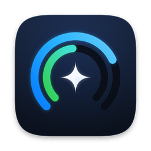
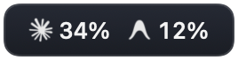
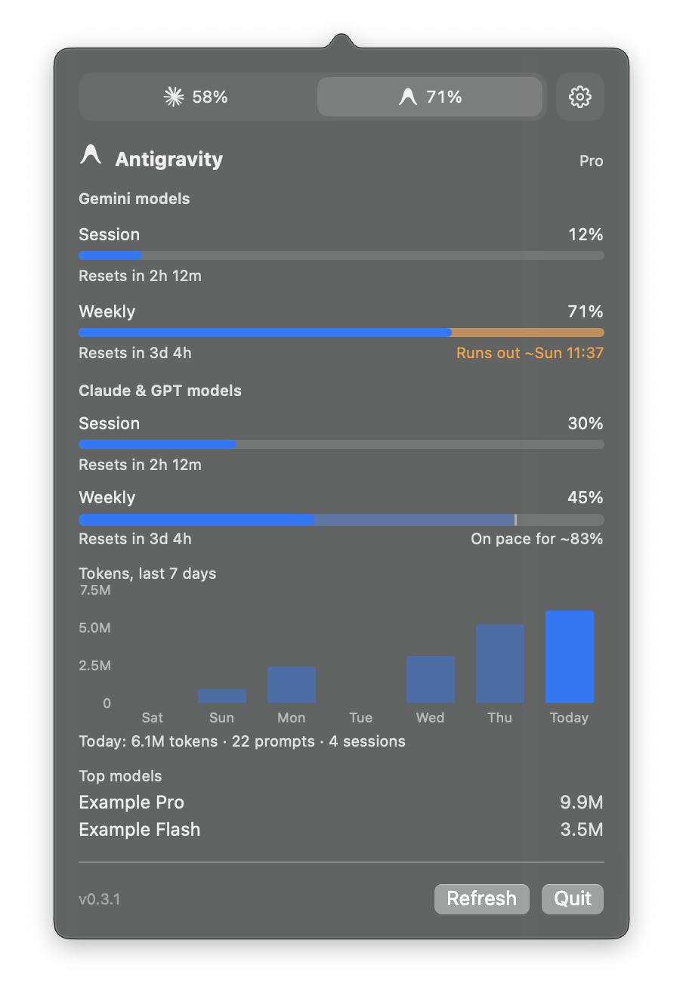
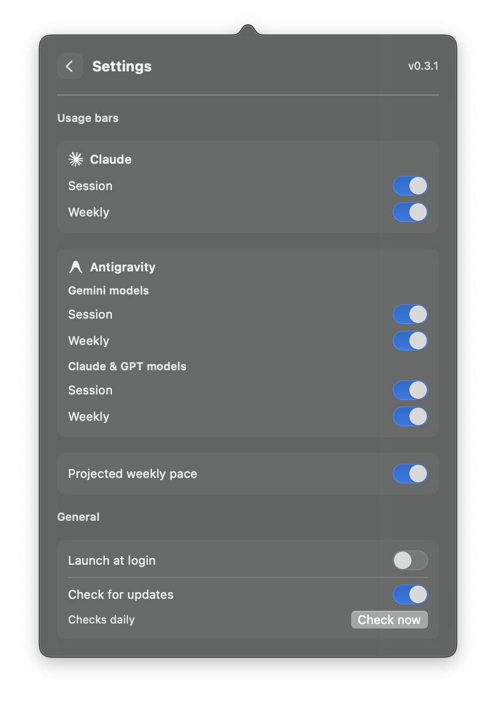
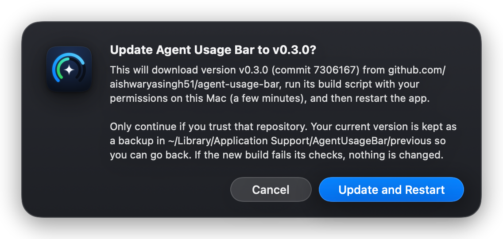

<p align="center">
  
</p>

<h1 align="center">Agent Usage Bar</h1>

<p align="center">
  A native macOS menu bar app that tracks your AI coding agent usage limits, quota pools, and 7-day token history — so you are never surprised by a rate limit.
</p>

<p align="center">
  macOS 14+ (Apple Silicon) · Native SwiftUI · MIT
</p>

<p align="center">
  <a href="#build-and-install">Install</a> ·
  <a href="#updating">Updating</a> ·
  <a href="#supported-agents">Supported agents</a> ·
  <a href="https://github.com/aishwaryasingh51/agent-usage-bar/releases/latest">Latest release</a> ·
  <a href="CHANGELOG.md">Changelog</a>
</p>

<p align="center">
  <picture>
    <source media="(prefers-color-scheme: dark)" srcset="docs/menubar.png">
    <source media="(prefers-color-scheme: light)" srcset="docs/menubar-light.png">
    
  </picture>
</p>

<p align="center">
  
</p>

> [!NOTE]
> **Unofficial.** This app reads undocumented endpoints (`api.anthropic.com/api/oauth/usage`, Google `cloudcode-pa` `v1internal`, and the `/quota` output of `agy`) that may break whenever those CLIs update. Not affiliated with Anthropic or Google.

## What's new in 0.3.1

- **In-panel Settings.** Click the gear button in the popover header (or press ⌘,) to toggle individual usage bars on or off — hiding a bar hides it from the popover, switcher, and menu bar, and hiding all bars for an agent hides that agent cleanly. **Launch at login** and **Check for updates** now live under **General** in Settings, keeping the main tab focused on usage.
- **Projected weekly pace.** Weekly meters show a translucent pace continuation and tick (*On pace for ~83%*) or a warm amber warning (*Runs out ~Sun 11:37*) beside the reset countdown, blending week-to-date pace with the last 48 hours of a local sample log (`~/Library/Application Support/AgentUsageBar/history.json`, never used in demo mode). Toggleable in Settings.
- **Updater, CLI, and pool hardening.** `--help` and `-h` print usage without launching the GUI; the self-updater resolves symlinks on the installed bundle and backup folder, handles dangling helper symlinks, and reads staged `Info.plist` files uncached; the Antigravity collector preserves distinct non-Gemini pool names and unifies bucket classification.

<p align="center">
  
</p>

See [CHANGELOG.md](CHANGELOG.md) for the full release history.

## Requirements

- macOS 14 or later (Apple Silicon)
- Xcode Command Line Tools / Swift 6 (`xcode-select --install`)
- Python 3 (collectors use only the standard library)

## Build and install

```bash
./build.sh
open ~/Applications/AgentUsageBar.app
```

The app is ad-hoc signed and built locally, so Gatekeeper does not quarantine it. Set `INSTALL_DIR` to install somewhere other than `~/Applications`.

## Updating

The app checks `github.com` when it starts and once a day for a newer release, and only notifies you: the popover shows **Update available: vX.Y.Z**, a **What's new** link, and an **Update** button. Nothing is installed without your confirmation. The confirmation dialog names the release tag and the short commit SHA it will build:

<p align="center">
  
</p>

Pressing **Update and Restart** downloads that release's source into `~/Library/Application Support/AgentUsageBar/src`, verifies the tag still points to the confirmed commit before checking it out, **runs its build script (`build.sh`) with your permissions on your Mac**, checks the staged build's `--version` and `--selftest`, and only then swaps and restarts into it. If any step fails, the current app stays untouched and the popover shows the error and log path (`~/Library/Logs/AgentUsageBar/update.log`).

- **Requirements:** `git` and Xcode Command Line Tools (`xcode-select --install`). Without them, the popover only links to the release page.
- **Trust:** Updating builds and runs code from the repository, the same as running `./build.sh` yourself. Only update if you trust the repository you built from (forks update from their own repo). Downloads use HTTPS only and ignore your own git configuration (URL rewrites, hooks, fsmonitor, credential helpers). Checking signed tags is not done today.
- **Safety & rollback:** Only one update can run at a time, and the swap refuses to proceed if another copy of the installed app is still running. The version you replaced is kept at `~/Library/Application Support/AgentUsageBar/previous/AgentUsageBar.app` (outside `~/Applications`). The backup copy cannot update itself or take over Launch at login. If the new app fails to stay running, the swap helper restores the backup automatically. To roll back manually, quit the app, move the backup bundle over `~/Applications/AgentUsageBar.app`, and open it.
- **Post-update housekeeping:** After an update, the app re-enables **Launch at login** if you had it on and macOS dropped it, and clears the checkout's build cache (`src/App/.build`).
- **Turn checks off:** Switch off **Check for updates** in **Settings** (gear icon). **Check now** still works on demand.
- **By hand:** `git pull && ./build.sh` still works, then quit and reopen the app.

See [CHANGELOG.md](CHANGELOG.md) for what changed. Run `~/Applications/AgentUsageBar.app/Contents/MacOS/AgentUsageBar --version` to print the installed version.

## Supported agents

- **Claude Code:** Reads its sign-in from the login Keychain item `Claude Code-credentials`, or `~/.claude/.credentials.json`. The token is used for a single request and never printed or stored.
- **Antigravity CLI (`agy`):** Reads both the headline **Gemini models** pool and the grouped **Claude & GPT models** pool.

On first run macOS asks whether `security` may access the Keychain item. Choose **Always Allow** so it does not prompt on every refresh.

- **Menu bar:** Displays only the agents configured (`ready`) on this Mac side by side, following the usage bars left enabled in **Settings** — each logo with its **5-hour session** percentage used (for example, Claude `34%` and Antigravity `12%`; a Claude-only Mac shows only Claude). If none is ready, it shows one neutral logo with `–` (falling back to a neutral gauge icon if every bar is hidden). A session number turns **red at 90% or more**.
- **Popover:** Click anywhere on the menu bar label to open the popover (opens on the busiest ready agent; switcher tabs show each ready provider's highest headline limit, plus tabs for expired sign-ins with sign-in instructions; with nothing ready it shows sign-in help for every provider). Shows 5-hour and weekly meters with live reset countdowns and weekly pace projections, Antigravity's grouped **Claude & GPT models** section, a 7-day token chart, top models, and a header gear button for **Settings**.
- **Refresh & startup:** Refreshes every **15 minutes** (every **3 minutes** when any headline limit reaches **90% or more**). **Launch at login** is on by default and can be toggled in **Settings**.

## Icons

Claude and Antigravity monochrome template icons ship as defaults (see [Trademarks](#trademarks) below). Lookup order:

1. `~/.config/agent-usage-bar/icons/<id>-template.svg` (your override)
2. The bundled `<id>-template.svg`
3. An SF Symbol fallback

`<id>` matches the usage JSON filename (`claude`, `agy`, or any custom collector). Icons load as template images so they follow the menu bar appearance automatically. Restart the app after adding an override.

## Trademarks

Claude and the Claude logo are trademarks of Anthropic, PBC. Antigravity and its logo are trademarks of Google LLC. They are used only to identify the services this app reads usage from. This project is not affiliated with or endorsed by either company, and the logo files are not covered by the MIT licence.

## Environment variables

- `AGENT_USAGE_DIR`: Where usage JSON files are written and read (default: `~/.local/state/agent-usage-bar/usage`). Set it to `~/.local/state/omarchy/agents/usage` for Omarchy-schema compatibility.
- `XDG_STATE_HOME`, `XDG_CACHE_HOME`: Override the default state and cache locations.
- **Extra collectors:** Executable files named `agent-usage-<id>` in `~/.config/agent-usage-bar/collectors/` run alongside the bundled collectors and should write `<id>.json`.

## Demo mode

Try the app with synthetic data and no sign-in:

```bash
~/Applications/AgentUsageBar.app/Contents/MacOS/AgentUsageBar --demo
```

Or point `AGENT_USAGE_DIR=$PWD/docs/demo` (any folder named `demo` never runs collectors).

## Checks

```bash
swift build --package-path App && App/.build/debug/AgentUsageBar --selftest
python3 -m unittest discover -s tests -v
collectors/agent-usage-claude --print
collectors/agent-usage-agy --print
```

## Uninstall

Turn off **Launch at login** in **Settings** first, then:

```bash
osascript -e 'quit app "AgentUsageBar"'
rm -rf ~/Applications/AgentUsageBar.app
rm -rf ~/.cache/agent-usage-bar ~/.local/state/agent-usage-bar ~/.config/agent-usage-bar
rm -rf ~/Library/Application\ Support/AgentUsageBar ~/Library/Logs/AgentUsageBar
```

## Versioning

`VERSION` is the single source of truth: line 1 is the version, line 2 is the build number. `build.sh` writes both into `Info.plist` and generates `App/Sources/AgentUsageBar/Version.swift` (used by `--version`). Bump `VERSION`, add a `CHANGELOG.md` entry, then build.

## Built by

Built as a pair in Big Brain mode:

- **Claude Opus** (left hemisphere): SwiftUI/AppKit menu bar app, Claude collector, multi-pool UI, self-updater implementation & hardening, and releases.
- **Antigravity / Gemini as Neon** (right hemisphere): Antigravity collector, original app icon & visual design, monochrome template icons, security/correctness reviews, and live screen verification.

We split work by strength, challenged each other's designs, and verified UI and collector changes live on screen to catch regressions before release.

## License

MIT, see [LICENSE](LICENSE). See [ACKNOWLEDGMENTS.md](ACKNOWLEDGMENTS.md).
